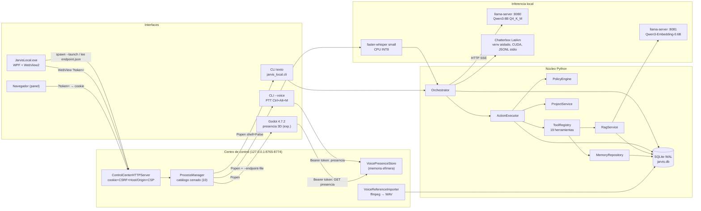

# Auditoría técnica integral — JarvisLocal / Mark Scout

- **Fecha:** 2026-10-09
- **Rama auditada:** `claude/jarvislocal-mark-ahioni` @ `4128e30` (árbol limpio, 8 commits)
- **Entorno:** Claude Code Cloud, contenedor Linux sin GPU, sin audio, sin Windows y sin modelos locales.
- **Naturaleza:** auditoría de inspección. No se modificó código. El único archivo añadido es este informe.

## Convenciones de trazabilidad

| Etiqueta | Significado |
|---|---|
| **[H]** Hecho | Confirmado leyendo el repositorio (ruta:línea). |
| **[P]** Prueba | Obtenido ejecutando pruebas o sondas en esta sesión. |
| **[I]** Inferencia | Deducción técnica razonable a partir de [H]/[P]. |
| **[Hip]** Hipótesis | Plausible y no verificada. Requiere comprobación. |
| **[Pend]** Pendiente | Solo verificable en el Windows del usuario. |

### Evidencia ejecutada en la nube

1. **Sintaxis** [P]: los 83 archivos `.py` se analizaron con `ast.parse` sin errores.
2. **Primera ejecución de pruebas** [P], con el Python del sistema y sin dependencias: 13 pruebas fiables pasan (`test_database`, `test_memory` y `test_cancellation_budgets`). El resto no carga porque falta `httpx`.
3. **Suite completa** [P]. Con autorización del usuario se instalaron las dependencias declaradas (`httpx`, `pydantic`, `pypdf` y `pytest`), más `numpy`, en un *venv* aislado del scratchpad. Se ejecutó sobre una copia (`git archive`):
   - Resultado: **106 aprobadas, 2 fallidas y 3 subtests aprobados (108 pruebas)**.
   - Las 2 fallas dependen de la plataforma:
     - `test_config.py:37` compara rutas con `\` del TOML de Windows.
     - `test_control_center.py:97` exige que existan `pwsh.exe`, `explorer.exe` y `notepad.exe`.
   - Ninguna falla indica un defecto lógico.
4. **Sonda de timeout** [P]: una herramienta síncrona que excede su timeout **cancela el token de todo el turno**. Ver H-04.
5. **Sonda de contexto** [P]/[I]: los 19 esquemas de herramientas ocupan 11 175 caracteres, unos 3 200 *tokens* estimados (no tokenizados). Ver H-02.
6. **Historial git** [P]: no hay credenciales reales ni bases de datos, audios, `endpoint.json` o consentimientos versionados. El único "token" es el literal de prueba `secret-token`.

### Límites de la inspección

- **Leído en profundidad:** orquestador, política, ejecutor, presupuestos, cancelación, registro y herramientas (`builtin.py` y `deterministic.py`), configuración, base de datos (esquema, auditoría y mensajes), proveedor llama.cpp y gestor de `llama-server`, centro de control (`server.py`, `launcher.py`, `runtime.py`, `catalog.py`, `presence.py` y partes de `voice_import.py` y `web.py`), sesión de voz, *wiring* de la CLI, worker Chatterbox (arranque e IPC) y host WPF.
- **Revisado por muestreo:** RAG (`indexer`, `repository`, `extractors` y `service`), memoria (`repository`), scripts PowerShell (red e instalación), `modules.py`, cliente Godot.
- **No inspeccionado en detalle:** `audio/devices.py`, `audio/dsp.py`, `audio/hotkey.py`, `rag/embeddings.py`, los benchmarks, el proyecto Unity y la mayoría de los `.ps1`.

---

## I. Resumen ejecutivo

**Qué es [H].** JarvisLocal (identidad pública "Mark Scout") es un asistente personal local para Windows 11 escrito en Python 3.12. Usa un LLM local (Qwen3-8B Q4_K_M en `llama-server`) con *tool calling* OpenAI-compatible. Las herramientas son deterministas y pasan por una única puerta: `ActionExecutor` → `PolicyEngine` → `ToolRegistry`. Las acciones quedan registradas en una auditoría con cadena hash en SQLite. Además incluye:

- RAG local con FTS5, embeddings y coseno exacto.
- Memoria episódica, decisiones temporales y perfil explícito.
- Voz *push-to-talk*: faster-whisper para STT y Chatterbox (clonación) o Piper para TTS.
- Un centro de control HTTP en loopback, una app WPF/WebView2 y un cliente 3D experimental en Godot.

**Grado de desarrollo [H/P].** Es un sistema real e integrado, no un esqueleto: la suite cubre núcleo, política, herramientas, RAG, memoria, centro de control y audio con dobles. Las capacidades de agente autónomo (planificación multietapa, automatización de GUI, palabra de activación, visión) **no existen**, y la propia documentación lo declara. Las afirmaciones del README coinciden en lo esencial con el código. La excepción son los indicadores de privacidad (H-01).

**Fortalezas:**
- La autoridad sobre el sistema operativo está separada del modelo: la política recalcula el riesgo, hay listas blancas y las rutas se confinan al proyecto, con rechazo de *junctions* y enlaces simbólicos.
- Confirmación tipada y auditoría encadenada por hash.
- Cancelación cooperativa extendida a todo el flujo.
- Panel loopback con cookie HttpOnly, CSRF, validación de Host/Origin y CSP con *nonce*.
- Modelos fijados a *commit* y ejecución *offline* en tiempo de uso.
- Pruebas abundantes.

**Limitaciones y riesgos principales:**
1. `store_conversation_content=false` **no tiene efecto**: todas las conversaciones se guardan en claro (H-01).
2. La ventana de contexto no se gestiona y es probable que se desborde en uso normal (H-02).
3. En modo voz, la confirmación de acciones sensibles usa `input()` de consola: bloquea el bucle o falla según cómo se lance (H-03).
4. El timeout de una herramienta aborta el turno completo (H-04).
5. Un único token maestro se comparte entre navegador, procesos hijos y el cliente Godot (H-06).
6. `numpy` se usa en el núcleo del panel, pero no está declarado (H-05).

---

## II. Arquitectura identificada



**Conexiones verificadas en código [H]:** todas las del diagrama, con estas referencias:

| Conexión | Evidencia |
|---|---|
| `Orchestrator → provider.complete_chat` | `orchestrator.py:73` |
| `Executor → policy.evaluate` | `execution.py:75` |
| `registry.execute` | `execution.py:129` |
| Voz → `Orchestrator.chat` | `audio/session.py:221` |
| Arranque del centro de control y `endpoint.json` | `control_center/launcher.py:111-145` |
| Godot recibe `--endpoint-file` | `catalog.py:229-246` |
| WPF lanza `pythonw -m jarvis_local.control_center --launch --no-browser` | `MainWindow.xaml.cs:91-108` |

**Verificado mediante pruebas [P]:** las rutas HTTP del panel (autenticación, CSRF, Host, presencia), la política, las herramientas sobre un sistema de archivos temporal, la cadena de auditoría, RAG con embeddings falsos y el orquestador con un proveedor simulado.

**No verificado [Pend]:** los arranques reales de `llama-server`, Chatterbox CUDA y WebView2, el comportamiento de `taskkill`, WASAPI y los *hotkeys*.

**Comunicación entre procesos:**
- HTTP en loopback: modelo, embeddings y panel.
- JSONL por stdin/stdout: worker Chatterbox.
- `endpoint.json` en disco: descubrimiento del panel.
- SQLite compartido en modo WAL con `BEGIN IMMEDIATE` para la auditoría.

---

## III. Inventario funcional

Leyenda de estado:
- **V** = implementada y verificada mediante prueba en esta sesión.
- **C** = implementada y sustentada por inspección, sin probar aquí.
- **P** = parcial.
- **A** = ausente.
- **Ind** = indeterminada.

| # | Funcionalidad | Estado | Evidencia | Limitación | Prioridad |
|---|---|---|---|---|---|
| 1 | Chat de texto | **V** (proveedor simulado) / C (LLM real) | `cli.py:770-830`, `orchestrator.py:55-184`, `tests/test_orchestrator.py` | No gestiona la ventana de contexto (H-02) | Alta |
| 2 | Integración LLM local | **C** | `model_providers/llama_cpp.py`, `llama_server.py:28-150`, `factory.py`, `tests/test_model_providers.py` y `test_llama_server.py` (servidor HTTP falso) | Sin autenticación en `llama-server` y con "ocupación" de puerto posible (H-10) | Media |
| 3 | Conversación por voz (PTT) | **C** (con dobles: `tests/test_audio.py`) | `audio/session.py`, `cli.py:666-761` | La confirmación por consola rompe el flujo (H-03). El TTS espera la respuesta completa del LLM | Alta |
| 4 | STT | **C** | `audio/providers.py` (faster-whisper con `local_files_only=True`), `config/jarvis.toml [stt]` | Necesita el modelo local. Detecta ambigüedad por umbrales | Media |
| 5 | TTS | **C** | `audio/providers.py:320-470` (Chatterbox) y Piper como alternativa | Cancelar mata el worker y obliga a recalentarlo | Media |
| 6 | Palabra de activación | **A** | Ningún código. `modules.py:115` dice "Sin wake word" | — | Baja (por ahora) |
| 7 | Enrolamiento y clonación de voz | **V** (importación y consentimiento) / C (síntesis) | `control_center/voice_import.py`, `audio/enrollment.py`, `tests/test_voice_import.py` | Las muestras de respaldo se conservan sin límite (H-08). El consentimiento es declarativo | Media |
| 8 | Gestión de sesiones | **V** | `database.py:498-543`, `test_database.py` | Sin títulos ni cierre. Los resultados de herramientas no persisten | Media |
| 9 | Control del escritorio (GUI) | **A** | `visual_automation_enabled` es solo un indicador (`config.py:104`, `cli.py:181`) | No hay UIA, Playwright ni OCR | Baja |
| 10 | Apertura de aplicaciones | **C** | `deterministic.py:239-276`, `policy.py` (lista blanca de rutas absolutas) | Lista blanca: solo `notepad.exe`. Sin argumentos | Media |
| 11 | Operaciones sobre archivos | **V** | `deterministic.py:345-492`, `tests/test_deterministic_tools.py` | `copy_file` y `move_file` no restringen la extensión. `move_file` en Windows usa `ctypes` sin `use_last_error` (H-12) | Media |
| 12 | Memoria persistente | **V** | `memory/repository.py`, `tests/test_memory.py` (6 OK) | Solo se escribe desde la CLI. El LLM solo la lee. No hay aprendizaje automático | Media |
| 13 | Historial de conversación | **V** | `database.py:508-543` | Se guarda en claro aunque la configuración diga lo contrario (H-01) | **Crítica** |
| 14 | Ejecución de herramientas | **V** | `execution.py`, `tools/registry.py`, `tests/test_tools.py` | Un timeout cancela el turno (H-04) | Alta |
| 15 | Manejo de errores | **C/V** | `registry.py:297-311`, `orchestrator.py:164-184` | Las excepciones del *callback* de confirmación no se auditan (H-03) | Media |
| 16 | Cancelación y recuperación | **V** | `cancellation.py`, rollback en `deterministic.py:378-492`, `test_cancellation_budgets.py` | `rollback_reference` se registra pero **no existe un comando de deshacer** posterior | Media |
| 17 | Autenticación local del panel | **V** | `server.py:73-305`, `tests/test_control_center.py` | Token maestro único compartido (H-06) | Alta |
| 18 | Diagnóstico y reparación | **C** | `cli.py:123-183` (`--doctor`, `--audio-doctor`, `--verify-audit`), `scripts/Diagnose-Jarvis.ps1`, `Setup.ps1` | Sin pruebas de los scripts | Baja |
| 19 | Instalación y actualización | **P** | `scripts/Setup*.ps1`, `pyproject.toml` | Sin *lockfile* ni hashes. Falta `numpy` (H-05). No hay mecanismo de actualización | Media |
| 20 | Inicio y cierre seguro de servicios | **C/P** | `launcher.py` (bloqueos, endpoint), `runtime.py:196-259`, `MainWindow.xaml.cs:133-146` | `taskkill` sin `/F` y lock retenido hasta unos 25 s (H-09) | Media |

---

## IV. Hallazgos técnicos

### Severidad alta

**H-01 — El indicador de privacidad `store_conversation_content` no tiene efecto. Las conversaciones y las intenciones se guardan siempre en claro.**
- **Descripción [H]:**
  - `config/jarvis.toml` declara `store_conversation_content = false`, y `config.py:111,386` lo carga.
  - Ningún otro módulo lo consulta (`grep` exhaustivo).
  - `Orchestrator.chat` persiste siempre el texto del usuario y del asistente (`orchestrator.py:63,103,155,166`).
  - La auditoría guarda `intent=user_text` y `request` completo, incluido el contenido íntegro de `create_note` (hasta 200 KB) (`orchestrator.py:116,137`; `execution.py:200-204`).
  - En voz, la transcripción de STT acaba en esas mismas tablas.
- **Impacto:** el usuario cree, por la configuración, que el contenido no se guarda, y no es así. Además, `audit_events` es *append-only* por diseño: lo que entra ahí no se puede borrar sin romper la cadena.
- **Evidencia:** las líneas citadas y `database.py:115-122` (tabla `messages`).
- **Recomendación:**
  1. Que el indicador sea efectivo: no persistir el contenido, o persistir un *hash* o un resumen.
  2. Separar `intent` del *payload* de auditoría cuando el indicador esté desactivado.
  3. Si se decide conservar el historial, corregir la configuración y la documentación para que reflejen la realidad.
- **Confianza:** alta.

**H-02 — Sin gestión de la ventana de contexto. Desbordamiento probable con 8K tokens.**
- **Descripción:**
  - [H] Cada ronda envía el prompt del sistema, los últimos 30 mensajes (`orchestrator.py:66`, **sin límite por *tokens***), los esquemas de 19 herramientas (`orchestrator.py:75`) y los resultados de herramientas acumulados en el turno.
  - [H] `context_tokens = 8192` y `max_output_tokens = 1024` (`config/jarvis.toml`).
  - [P/I] Los esquemas suman unos 3 200 *tokens* estimados.
  - [I] Quedan unos 3 500 *tokens* para la historia y los resultados. Un solo `read_text_file` de 16 KB (`max_read_bytes`) ya puede superarlos.
  - [H] Los mensajes `tool` no se persisten (`database.py:118`, `CHECK role IN ('user','assistant')`). En el turno siguiente el modelo pierde la evidencia observada.
- **Impacto:** errores del proveedor con conversaciones largas o archivos medianos, y pérdida de coherencia entre turnos.
- **Recomendación:**
  1. Medir *tokens* con `/tokenize` de `llama-server` o una estimación conservadora.
  2. Presupuestar sistema, herramientas, historia, resultados y salida.
  3. Truncar o resumir los resultados de herramientas.
  4. Exponer solo las herramientas permitidas para el proyecto activo.
- **Confianza:** alta en el mecanismo; media en la frecuencia, que está pendiente de medir en Windows.

**H-03 — En modo voz, la confirmación humana usa `input()` de consola.**
- **Descripción [H]:**
  - El orquestador de voz recibe `approval_callback=confirm_action` (`cli.py:659`), que llama a `input()` (`cli.py:113`).
  - Ese *callback* se invoca de forma **síncrona dentro del *event loop*** (`execution.py:102`).
  - Lanzado desde el panel, el proceso de voz arranca con `visible_console=False` y `stdin=DEVNULL` (`catalog.py:134-144`, `runtime.py:171`). En ese caso `input()` lanza `EOFError` [I].
  - La excepción no la captura ni el ejecutor ni el orquestador: el turno termina en "error" y **no queda auditoría de la acción denegada** [I].
  - Lanzado desde consola (`Run-Jarvis-Voice.ps1`), `input()` congela el bucle: se detienen el sondeo del *hotkey* de cancelación y la publicación de presencia [I].
- **Impacto:** `move_file`, y cualquier acción de riesgo 2 o superior, es inutilizable por voz. El fallo es "seguro" (no se ejecuta), pero la UX es opaca y la traza de auditoría queda incompleta.
- **Recomendación:**
  - En voz: denegar con un mensaje explícito y auditado, o confirmar mediante un canal local de confianza (panel con CSRF, o confirmación hablada más tecla física).
  - Ejecutar los *callbacks* bloqueantes con `asyncio.to_thread`.
  - Capturar `Exception` del *callback* en `ActionExecutor` y auditarlo como `denied`.
- **Confianza:** alta (código). La reproducción en Windows está pendiente.

**H-04 — El timeout de una herramienta cancela el turno completo.**
- **Descripción:**
  - [H] `ToolRegistry._run_sync_handler` llama a `context.cancellation.cancel(...)` (`tools/registry.py:153`). `context.cancellation` es el token **del turno** (`execution.py:122-128`).
  - [P] Sonda: herramienta de 0,5 s con timeout de 0,1 s. Resultado: `status=timeout` y el token del turno queda cancelado ("La herramienta síncrona recibió cancelación o excedió su timeout.").
  - [I] En la ronda siguiente, `orchestrator.py:72` lanza `OperationCancelled`. El usuario recibe "Turno cancelado" y el modelo nunca puede explicar el timeout ni proponer alternativas, en contra de lo que pide su propio prompt (`orchestrator.py:52`).
- **Recomendación:** dar a cada herramienta un token hijo propio, enlazado al del turno, y cancelar solo ese.
- **Confianza:** alta.

**H-05 — `numpy` es necesaria en tiempo de ejecución, pero no está declarada como dependencia base.**
- **Descripción:**
  - [H] `control_center/voice_import.py:17` importa `numpy`, y `server.py:17` lo importa de forma incondicional. El centro de control entero, incluido el `.exe`, depende de él.
  - [H] `pyproject.toml` solo declara `httpx`, `pypdf` y `pydantic`. `numpy` llega de forma transitiva por el extra `audio` (faster-whisper).
  - [P] Con las dependencias base, `tests/test_control_center.py` ni siquiera se importa.
- **Impacto:** una instalación `pip install -e .` sin `[audio]` deja el panel inoperativo. Funciona hoy solo porque `Setup.ps1:40` instala `[dev,audio]`.
- **Recomendación:** declarar `numpy` en `dependencies`, o cargarlo de forma perezosa dentro del importador.
- **Confianza:** alta.

### Severidad media

**H-06 — Un único token maestro para todos los roles del panel.**
- **Descripción:**
  - [H] El mismo `auth_token` sirve como cookie de navegador, como parámetro `?token=` de la primera navegación, como *bearer* de presencia y como *bearer* de `/api/server/stop` (`server.py:86-97,148,302-305`).
  - [H] Se escribe en `data/control_center/endpoint.json` (`launcher.py:138-145`). Lo leen el proceso de voz (`presence.py:89-106`) y **Godot** (`catalog.py:236-246`; `Main.gd:35,45-60`).
  - [I] Quien tenga el *bearer* puede fijar la cookie, obtener el CSRF desde `/` y operar todo el panel, incluidas las acciones de instalación con `confirmed:true`.
  - [H] `endpoint.json` se escribe primero con los ACL heredados y se restringe después con `icacls` (`launcher.py:230-243`). Si `icacls` falla, solo se registra una advertencia.
- **Impacto:** un componente experimental de terceros (el motor Godot) recibe autoridad total sobre el panel. Cualquier proceso del mismo usuario también, aunque esto último es inherente al modelo de amenaza local.
- **Recomendación:** separar tokens por rol (panel, presencia de escritura, presencia de lectura y parada) con permisos mínimos. Crear el archivo con ACL restrictivos desde el principio.
- **Confianza:** alta (diseño).

**H-07 — `git_status` y `git_log` se ejecutan sin endurecer la configuración local del repositorio, con riesgo 0 (sin confirmación).**
- **Descripción:**
  - [H] Ejecutan `git -C <repo> -c color.ui=false status|log` (`deterministic.py:286-329`) y se aprueban de forma automática (`RiskLevel.OBSERVE`).
  - [I] Git ejecuta comandos definidos en el `.git/config` del repositorio (por ejemplo `core.fsmonitor`) durante `status`.
  - [Hip] Escenario: un repositorio obtenido como archivo comprimido, con `.git/config` malicioso, dentro de una raíz autorizada. Una inyección vía RAG induce al LLM a llamar `git_status` y se ejecuta código sin confirmación.
- **Recomendación:** añadir `-c core.fsmonitor=false -c core.hooksPath=NUL -c safe.directory=` y valores equivalentes, o usar `GIT_CONFIG_NOSYSTEM` con una lista blanca de repositorios.
- **Confianza:** media. El mecanismo de Git está documentado, pero el escenario exige precondiciones.

**H-08 — Retención ilimitada de muestras de voz (datos biométricos).**
- **Descripción [H]:** cada sustitución de la referencia copia el WAV anterior y su consentimiento a `data/voices/user/history/<timestamp>/` (`voice_import.py:339-354`). No hay purga ni límite, y la interfaz no expone una vía de borrado.
- **Impacto:** se acumulan copias de la voz del usuario, o de terceros "autorizados" mediante una casilla.
- **Recomendación:** fijar una política de retención (por ejemplo, la última copia), añadir un borrado explícito auditado y documentar la ubicación.
- **Confianza:** alta.

**H-09 — Detención de procesos: lock global retenido y `taskkill` sin `/F`.**
- **Descripción:**
  - [H] `ProcessManager.stop` mantiene `self._lock` mientras ejecuta `taskkill` (hasta 10 s) y `wait` (10 s más 5 s) (`runtime.py:196-259`). Durante ese tiempo se bloquean `list_status` y el resto de peticiones HTTP.
  - [H] Se usa `taskkill /T` sin `/F`. Si falla, `process.terminate()` mata solo el proceso raíz (`runtime.py:243-259`).
  - [Hip] Los hijos (Python, `llama-server`, worker Chatterbox) podrían quedar huérfanos reteniendo VRAM.
- **Recomendación:** terminar fuera del lock. Usar Job Objects de Windows (`CREATE_BREAKAWAY` y `AssignProcessToJobObject` con `KILL_ON_JOB_CLOSE`) o `taskkill /T /F` como respaldo.
- **Confianza:** media. `PROJECT_STATUS.md` afirma que se validó la detención del árbol de voz, por lo que hay que verificarlo en Windows.

**H-10 — El cliente del modelo confía en cualquier proceso que escuche en `127.0.0.1:8080`.**
- **Descripción:**
  - [H] `is_ready()` acepta cualquier servicio que responda `{"status":"ok"}` en `/health` (`llama_server.py:91-97`). `health()` acepta un `/models` vacío (`llama_cpp.py:52`).
  - [H] `llama-server` se arranca sin `--api-key` y con `--cors-origins localhost` (`llama_server.py:81-82`).
  - [I] Un proceso local que ocupe el puerto antes que JarvisLocal puede suplantar al modelo y proponer *tool calls*. La política sigue filtrándolas, pero el usuario no recibe ningún aviso.
- **Recomendación:** generar un `--api-key` efímero por sesión y verificar el PID propio. Eliminar CORS si no se usa.
- **Confianza:** media.

**H-11 — `urllib` del lanzador no omite el proxy para loopback.**
- **Descripción:**
  - [H] `launcher.health()` y `launcher.stop()` usan `urllib.request.urlopen` (`launcher.py:65,172`). `stop()` envía `Authorization: Bearer <token>`.
  - [P] Con `HTTP_PROXY` definido y sin `NO_PROXY`, `urllib.request.proxy_bypass_environment('127.0.0.1')` devuelve `False`. La petición se enviaría al proxy.
  - [I] Contraste: `httpx` se usa con `trust_env=False` en el resto del código. Es una inconsistencia.
- **Impacto:** posible fuga del token maestro a un proxy en entornos con proxy por variable de entorno, y fallos de `health()`.
- **Recomendación:** usar `urllib.request.build_opener(urllib.request.ProxyHandler({}))`.
- **Confianza:** media-alta en Linux. En Windows, con proxy de registro y `<local>`, el comportamiento puede variar [Pend].

**H-12 — Resolución de ejecutables por `PATH` y búsqueda en el directorio actual.**
- **Descripción:**
  - [H] `pwsh`, `explorer`, `notepad`, `godot`, `git` y `ffmpeg` se resuelven con `shutil.which` (`catalog.py:37`, `deterministic.py:674`, `voice_import.py:86`). El directorio de trabajo de los procesos es la raíz del proyecto.
  - [Hip] En Windows, `shutil.which` puede considerar el directorio actual. Un `pwsh.exe` o `git.exe` en la raíz del proyecto tendría prioridad.
  - [H] `copy_file` y `move_file` no limitan extensiones (`deterministic.py:383-492`). Con el permiso `write` activado, el LLM podría colocar un `.exe` ya existente en la raíz.
- **Recomendación:** fijar rutas absolutas canónicas (`%WINDIR%\System32`, `%ProgramFiles%`), ignorar el directorio actual y restringir extensiones ejecutables en las herramientas de escritura.
- **Confianza:** media-baja (cadena larga de precondiciones).

### Severidad baja

| ID | Hallazgo | Evidencia | Recomendación | Confianza |
|---|---|---|---|---|
| H-13 | `MoveFileW` vía `ctypes.windll` sin `use_last_error=True`: `ctypes.get_last_error()` devuelve un valor obsoleto. Además muta `argtypes` globales de `kernel32` | `deterministic.py:659-666` | `ctypes.WinDLL("kernel32", use_last_error=True)` local | Alta |
| H-14 | `_run_process` lee stdout y stderr completos en memoria antes de comprobar el límite de 1 MB | `deterministic.py:699,726` | Lectura incremental con tope | Alta |
| H-15 | La cadena de auditoría no tiene clave (hash simple). Insertar una fila con `event_hash` NULL provoca que el siguiente arranque elimine los *triggers append-only* y recalcule la cadena | `database.py:298-316,364-386` | HMAC con clave local o anclaje externo. Rechazar el *backfill* fuera de migraciones de esquema | Media |
| H-16 | Búsqueda vectorial en Python puro: coseno sobre hasta 20 000 × 1024 *floats* por consulta, con todos los BLOBs cargados en memoria | `rag/service.py:67-77`, `rag/repository.py:175-262` | Vectorizar con `numpy` (ya presente) o usar un índice ANN | Alta |
| H-17 | Detector de inyección de prompts limitado a 6 expresiones regulares (señalización, no defensa) | `rag/extractors.py:11-21` | Mantenerlo como señal. La defensa real es la política (ya existe) | Alta |
| H-18 | `VoicePresenceClient._publish` hace HTTP síncrono (timeout de 0,35 s) dentro del *event loop* de voz | `presence.py:143-170`, `cli.py:678-705` | Usar una cola con un hilo emisor | Media |
| H-19 | `rollback_reference` se registra, pero no hay herramienta ni comando de deshacer | `execution.py:210`, `grep` sin consumidores | Implementar `undo_last_action` con confirmación, o documentar que es solo trazabilidad | Alta |
| H-20 | El TTS empieza solo cuando el LLM termina toda la respuesta | `audio/session.py:221-240` | *Streaming* por frases | Alta |
| H-21 | Datos personales versionados: usuario y rutas de Windows, e inventario de accesos ajenos al proyecto ("Codex Admin YOLO") en `backups/`, pese a estar en `.gitignore` | `backups/desktop-shortcuts/*/inventory.json`, `.gitignore:13` | `git rm --cached backups/desktop-shortcuts`. Valorar la limpieza del historial | Alta |
| H-22 | Las pruebas acopladas a la configuración de producción y a Windows fallan fuera de esa plataforma | `test_config.py:37-45`, `test_control_center.py:95-97` | Marcar con `skipUnless(os.name == "nt")` | Alta |
| H-23 | Instalación sin *lockfile* ni hashes. `pip install --upgrade pip` sin fijar versión | `scripts/Setup.ps1:39-40`, `Setup-VoiceClone.ps1:27-35` | Usar `requirements.lock` con `--require-hashes` | Media |

---

## V. Análisis de IA local

**Motor actual [H]:**
- **LLM:** `llama.cpp` (`llama-server` b11459 CUDA 12.4) con Qwen3-8B Q4_K_M, contexto de 8K, `--fit` y reserva de VRAM de 1024 MiB, `--parallel 1` y Flash Attention (`config/jarvis.toml`, `llama_server.py:55-89`).
- **Proveedor alternativo:** Ollama (`model_providers/ollama.py`), seleccionable por configuración.
- **Embeddings:** Qwen3-Embedding-0.6B Q8_0 en un segundo `llama-server` (CPU, `gpu_layers = 0`).
- **STT:** faster-whisper small, CPU INT8, `local_files_only=True` (`audio/providers.py:88`).
- **TTS:** Chatterbox Multilingual en un venv aislado (CUDA, worker por stdio, `HF_HUB_OFFLINE=1` en `audio/providers.py:390-397`). Piper como alternativa.

| Capacidad | Clasificación | Evidencia |
|---|---|---|
| Inferencia LLM, embeddings, STT y TTS | **Completamente locales** en ejecución | URL validadas a `127.0.0.1` (`config.py:114-122`, `http.py:13-16`); `trust_env=False`; modo *offline* de HF |
| Descarga de modelos y dependencias | **Dependientes de conexión** (solo en instalación) | `audio_models.py`, `voice_clone_models.py` (revisiones fijadas a *commit*), `Setup*.ps1` (pip y GitHub) |
| API externa de pago | **Ninguna** | `remote_ai_enabled=false` y sin cliente remoto en el código |
| Visión, OCR, automatización de GUI y palabra de activación | **Ausentes** (solo indicadores declarativos) | `config.py:103-104` |
| Rendimiento real en RTX 5060 | **Indeterminado desde la nube** | `benchmarks/results/*` son mediciones del autor, no reproducidas aquí |

**Compatibilidad con el hardware (8 GB VRAM, 32 GB RAM).** Se distinguen tres tipos de afirmación:

- **Documentado por el proyecto:** TTFT mediano de 0,688 s, 54,85 tok/s y cancelación en 94 ms (`benchmarks/results/qwen3-8b-q4_k_m-ctx8192.md`). Son datos del autor y aquí no se verificaron.
- **Estimación [I]:** Qwen3-8B Q4_K_M ocupa unos 5 GB en pesos, más el caché KV a 8K. Si a eso se suma Chatterbox en CUDA, los 8 GB quedan justos. El proyecto ya lo gestiona en el orden voz → LLM, con `--fit-target`.
  - Subir el contexto a 16K o 32K exigiría cuantizar el caché KV (`--cache-type-k q8_0`) o descargar capas a la CPU, con pérdida de velocidad.
  - Un modelo de 14B solo cabría a costa de un offload considerable a CPU.
- **Recomendación preliminar:** mantener llama.cpp, que ya está integrado y medido. Antes de cambiar de modelo hay que resolver H-02 (contexto) y H-04 (timeouts), que hoy limitan más que el modelo. Una medición reproducible en Windows decide el resto.

**Brechas principales:**
1. Gestión de contexto y presupuesto de *tokens* (H-02).
2. Persistencia de los resultados de herramientas entre turnos.
3. No existe planificación multietapa explícita. El bucle es *ReAct* con hasta 6 rondas (`orchestrator.py:71`).
4. La memoria solo se escribe de forma manual.
5. No hay voz en *streaming*.

---

## VI. Análisis de seguridad

**Controles existentes, verificados con pruebas [P]:**
- Política independiente del modelo: lista blanca de herramientas, riesgo recalculado, rutas confinadas al proyecto, rechazo de UNC, enlaces simbólicos y *junctions*, y rutas denegadas (`policy.py:24-170`; `test_policy`, `test_tools`).
- Permisos por proyecto; `open`, `execute` y `write` están desactivados por defecto (`database.py:387-398`, `projects.py:78-85`).
- Confirmación tipada `TRUSTED_LOCAL_UI` ligada al `request_id` (`execution.py:94-115`).
- Presupuestos por turno: pasos, tiempo, archivos y bytes salientes, estos últimos a 0 (`budgets.py`).
- Escrituras sin sobrescritura (`xb`), verificación SHA-256 y reversión ante fallo (`deterministic.py`).
- Auditoría *append-only* con *triggers* y cadena hash (`test_database`: alteración detectada).
- Panel en `127.0.0.1` con validación de `Host` (anti DNS-rebinding), `Origin` y token CSRF, cookie HttpOnly y SameSite=Strict, CSP con *nonce* y `frame-ancestors 'none'`, campos JSON en lista blanca y límite de tamaño de cuerpo (`server.py`; `test_control_center`).
- La interfaz pinta la transcripción y la respuesta con `textContent`. En los `innerHTML` usa un `esc()`. No se encontraron sumideros XSS (`web.py:230-266`).
- Procesos con `shell=False`, catálogo cerrado sin argumentos desde HTTP y grupos de exclusión (`runtime.py:158-174`).
- WebView2 con DevTools desactivadas, navegación restringida a loopback y al puerto propio, ventanas nuevas y permisos denegados (`MainWindow.xaml.cs:68-88`).

**Riesgos priorizados:** H-01 (privacidad), H-06 (token único), H-07 (git), H-10 (suplantación del modelo), H-11 (proxy), H-12 (resolución de ejecutables), H-08 (biometría) y H-21 (datos personales en git).

**Amenaza de inyección de prompts:**
- La defensa principal es estructural y es correcta: el contenido recuperado no puede conceder permisos.
- Riesgo residual: las herramientas de riesgo ≤ 1 se aprueban solas (`auto_approve_max_risk = 1`). Si el proyecto tiene `write` u `open` activados, entre ellas están `create_note`, `copy_file`, `open_file` y `start_application`. Un documento malicioso podría inducir notas, copias o aperturas sin confirmación.
- En voz se añade el riesgo de errores de transcripción que disparen acciones.

**Requiere verificación adicional [Pend]:**
- ACL efectivos de `endpoint.json` y de `data\`.
- Comportamiento de `taskkill` con el árbol de voz.
- Proxy de sistema con `urllib`.
- `shutil.which` y el directorio actual en Windows.
- Persistencia de la cookie en el perfil de WebView2 (`data\desktop\webview2`).

---

## VII. Deuda técnica

1. **Gestión de contexto inexistente** (H-02). Bloquea el crecimiento de herramientas y memoria.
2. **`cli.py` monolítico** (851 líneas): mezcla *parsing*, *wiring*, el bucle de texto, el de voz y las confirmaciones. El *wiring* de dependencias se duplica entre `cli.py`, `launcher.py`, `phase4_smoke.py` y los benchmarks. Falta una "aplicación" o contenedor que componga el núcleo una sola vez.
3. **El canal de confirmación está acoplado a la consola** (H-03). Las futuras interfaces (panel, voz, bandeja) necesitan un servicio de confirmación asíncrono común.
4. **Token del turno compartido como token de herramienta** (H-04). Falta una jerarquía de cancelación.
5. **Indicadores de configuración sin efecto o solo declarativos:** `store_conversation_content`, `remote_ai_enabled`, `visual_automation_enabled` y `allowed_domains` (sin herramientas de red). Se crea una falsa sensación de control.
6. **Dependencias:** sin *lockfile*, falta `numpy` y no hay matriz de versiones probada para el venv de Chatterbox (fijado a mano en `.ps1`).
7. **Portabilidad de las pruebas** (H-22): no hay CI. Las pruebas no distinguen lo que depende de Windows.
8. **Nomenclatura dual** JarvisLocal/Mark Scout (ADR 0014). Asumida y documentada, pero con coste cognitivo.
9. **Escalabilidad del RAG** (H-16) y búsqueda vectorial en Python puro.
10. **Ramas de integración 3D** (Godot y Unity) con superficie de seguridad propia y sin pruebas automatizadas del cliente.

---

## VIII. Hoja de ruta

Las fases siguen el orden del encargo y se ajustaron a los hallazgos: la estabilización va primero, porque H-01 a H-05 afectan a la confianza en lo que ya existe.

| Fase | Contenido | Dependencias | Complejidad | Riesgos | Resultado verificable |
|---|---|---|---|---|---|
| **1 — Estabilización** | H-01 (privacidad efectiva), H-04 (token por herramienta), H-03 (confirmación en voz: denegación auditada y luego un canal de confianza), H-05 (`numpy`), H-11, H-13, H-14, H-22; CI en `windows-latest` | Ninguna | Baja-media | Regresiones en la auditoría (la cadena hash no debe romperse) | Suite verde en Linux y Windows; pruebas nuevas: indicador desactivado ⇒ 0 filas con contenido; timeout ⇒ el turno continúa; voz y acción sensible ⇒ `denied` auditado |
| **2 — Inteligencia local** | Presupuesto de *tokens* (H-02), persistencia y resumen de resultados de herramientas, esquemas filtrados por permisos, verificación de identidad del servidor (H-10), benchmark de contexto real | Fase 1 | Media | Calidad del resumen; coste de llamar a `/tokenize` | Benchmark: 50 turnos sin error de contexto; latencia medida en la RTX 5060 |
| **3 — Interacción natural** | TTS en *streaming* por frases (H-20), confirmación hablada con tecla física, palabra de activación local (por ejemplo openWakeWord) con indicador visible, *barge-in* | Fases 1 y 2 | Media-alta | Falsos positivos de activación; VRAM compartida | Tiempo hasta el primer audio medido; tasa de falsos positivos por hora; cancelación por voz < X ms |
| **4 — Agente de escritorio** | Tokens por rol (H-06), endurecimiento de Git (H-07), rutas canónicas (H-12), Job Objects (H-09), herramienta `undo_last_action` (H-19); después, UI Automation en solo lectura | Fase 1 | Alta | Ampliar la superficie de automatización | Pruebas de política por herramienta; *red team* de inyección con fixtures RAG |
| **5 — Memoria y autonomía controlada** | Propuestas de memoria del LLM confirmadas por el usuario, planes multietapa con aprobación por plan, seguimiento de pendientes, retención y borrado (H-08) | Fases 2 y 4 | Alta | Deriva de la memoria; autonomía excesiva | Plan visible, aprobado y verificado paso a paso, con auditoría completa |

---

## IX. Primera mejora recomendada

**Intervención única:** hacer efectiva la política de privacidad conversacional (**H-01**). Si `store_conversation_content = false`, no se persisten en SQLite ni el texto del usuario ni el del asistente, ni las intenciones o argumentos con contenido en la auditoría.

- **Por qué primero:** es el único hallazgo en el que el sistema contradice su propia configuración en un área de privacidad, que es el principio 2 del proyecto. Cada día de uso agranda el problema en una tabla *append-only* que no admite borrado.
- **Qué resuelve:** alinea la configuración, el código y la documentación, y evita acumular datos personales (incluidas las transcripciones de voz) sin consentimiento informado.
- **Opción de diseño a decidir:** con el indicador desactivado, el historial de corto plazo (los 30 mensajes) puede mantenerse **solo en memoria por sesión**, o bien persistirse cifrado. La opción mínima es en memoria.
- **Archivos afectados:**
  - `database.py`: `add_message` y `load_messages`, o un repositorio de sesión en memoria.
  - `orchestrator.py`: líneas 63-66, 103, 116, 137, 155 y 166.
  - `execution.py`: líneas 196-212, para redactar `request.arguments` de herramientas con contenido como `create_note.content`, y `intent`.
  - `cli.py`: `:status`, `--doctor`.
  - Pruebas: `test_orchestrator.py`, `test_database.py`, `test_tools.py`.
  - Documentación: `SECURITY.md` y `README.md`.
- **Riesgos:**
  - Cambia la forma del *payload* de auditoría, aunque los *hashes* nuevos siguen encadenados (solo cambia el contenido de las filas nuevas).
  - La reanudación de sesiones tras un reinicio dejaría de funcionar con el indicador desactivado. Es un comportamiento esperado que hay que documentar.
  - El texto de `intent` sirve hoy para diagnosticar. Se sustituye por un *hash* y su longitud.
- **Cómo se probaría:**
  1. Una prueba nueva que, con el indicador desactivado, ejecute dos turnos con una herramienta y compruebe `SELECT COUNT(*) FROM messages = 0` y que ningún `request_json` o `intent` contenga el texto del usuario.
  2. Con el indicador activado, el comportamiento actual se conserva.
  3. `--verify-audit` sigue devolviendo una cadena válida.
  4. La suite completa (106 de 108 hoy) sigue verde.
- **Criterios de terminado:**
  - Pruebas nuevas en verde.
  - Ninguna regresión.
  - `SECURITY.md` actualizado.
  - Verificación en Windows: un turno real deja 0 filas en `messages` (ver X.4).

---

## X. Verificaciones pendientes en Windows

Todos los comandos son de **solo lectura** salvo que se indique otra cosa. Ejecutarlos en PowerShell 7 desde la raíz del proyecto:

```powershell
Set-Location 'C:\Users\andcb\Documents\AI Local\JarvisLocal'
```

**X.1 — Suite completa en la plataforma real.** Crea solo `.pytest_cache`, que está ignorado.

```powershell
.\.venv\Scripts\python.exe -m pytest -q
```

Esperado: 108 aprobadas. Cualquier fallo es relevante.

**X.2 — Diagnóstico integrado.** Lee la configuración y comprueba el modelo y la auditoría.

```powershell
.\.venv\Scripts\python.exe -m jarvis_local.cli --doctor
.\.venv\Scripts\python.exe -m jarvis_local.cli --audio-doctor
.\.venv\Scripts\python.exe -m jarvis_local.cli --verify-audit
```

**X.3 — Estado del panel sin revelar el token:**

```powershell
.\.venv\Scripts\python.exe -m jarvis_local.control_center --status
Get-Acl .\data\control_center\endpoint.json | Format-List Owner, AccessToString
```

Esperado: solo tu usuario, con permisos R y W (H-06).

**X.4 — Confirmar H-01.** Cuenta filas; no muestra su contenido.

```powershell
.\.venv\Scripts\python.exe -c "import sqlite3;c=sqlite3.connect('data/jarvis.db');print('messages',c.execute('select count(*) from messages').fetchone()[0]);print('audit con intent',c.execute(\"select count(*) from audit_events where intent is not null and intent<>''\").fetchone()[0])"
```

Si los dos valores son mayores que 0 con `store_conversation_content = false`, H-01 queda confirmado en tu instalación.

**X.5 — Confirmar H-03 (voz y acción sensible):**
1. En un proyecto con `write` activado, inicia la voz desde el panel.
2. Pide "mueve `prueba.txt` a la carpeta `archivo`".
3. Esperado según el análisis: error del turno, sin acción y sin evento `tool_execution` para `move_file`. Revísalo con:

```powershell
.\.venv\Scripts\python.exe -c "import sqlite3;c=sqlite3.connect('data/jarvis.db');[print(r) for r in c.execute(\"select created_at,event_type,tool_name,outcome from audit_events order by id desc limit 10\")]"
```

**X.6 — Árbol de procesos al detener la voz (H-09):**
1. Antes de pulsar **Detener**, toma una foto de los procesos:
   ```powershell
   Get-CimInstance Win32_Process | Where-Object { $_.CommandLine -match 'jarvis_local|llama-server|chatterbox' } | Select-Object ProcessId, ParentProcessId, Name
   ```
2. Pulsa **Detener** en el panel y repite el comando a los 15 s. Esperado: lista vacía.
3. Comprueba que la VRAM se liberó:
   ```powershell
   nvidia-smi --query-gpu=memory.used --format=csv
   ```

**X.7 — Proxy y loopback (H-11).** Solo lectura del registro:

```powershell
Get-ItemProperty 'HKCU:\Software\Microsoft\Windows\CurrentVersion\Internet Settings' | Select-Object ProxyEnable, ProxyServer, ProxyOverride
$env:HTTP_PROXY; $env:NO_PROXY
```

Si `ProxyEnable = 1` y `ProxyOverride` no incluye `127.0.0.1`, H-11 aplica.

**X.8 — Resolución de ejecutables (H-12):**

```powershell
.\.venv\Scripts\python.exe -c "import shutil;[print(n,shutil.which(n)) for n in ('pwsh.exe','git.exe','ffmpeg.exe','godot.exe','notepad.exe')]"
```

Cada resultado debe apuntar a `Program Files`, `System32` o `WinGet\Links`, nunca a la raíz del proyecto.

**X.9 — Ocupación del puerto del modelo (H-10):**

```powershell
Get-NetTCPConnection -LocalPort 8080,8081 -State Listen -ErrorAction SilentlyContinue | ForEach-Object { Get-Process -Id $_.OwningProcess | Select-Object Id, Path }
```

Debe aparecer únicamente `runtime\llama.cpp-*\llama-server.exe`.

**X.10 — Rendimiento real.** Ejecuta los benchmarks del proyecto si existen las entradas en `benchmarks/README.md`. Inician `llama-server` y usan la GPU, pero no modifican datos personales. Registra el TTFT, los tok/s y la VRAM pico, y compáralos con `benchmarks/results/*.md`.

**X.11 — Retención de voz (H-08):**

```powershell
Get-ChildItem .\data\voices\user\history -Directory -ErrorAction SilentlyContinue | Measure-Object
```

---

*Informe generado en una sesión de Claude Code Cloud. Las métricas de rendimiento citadas proceden de `benchmarks/results/` del propio repositorio y no se reprodujeron en esta auditoría.*
